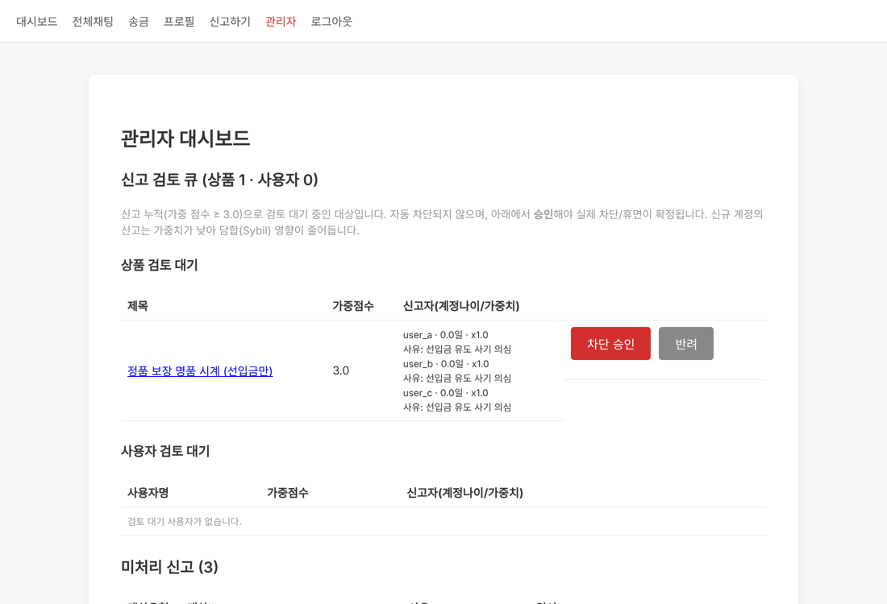
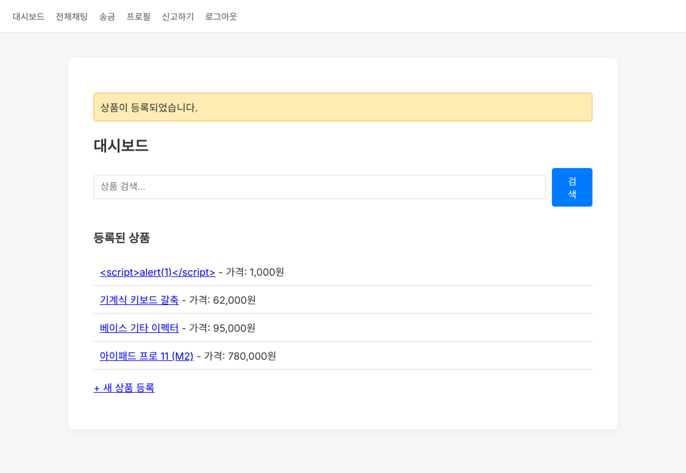
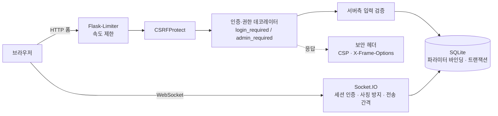

<div align="center">

# 🛒 Secure Second-hand Market

**취약한 Flask 스타터 코드를 받아, 위협을 하나씩 찾아 막고<br>모든 방어를 자동화된 공격 테스트로 증명한 중고거래 플랫폼**

[](https://github.com/shinu61/secure_coding_homework/actions/workflows/tests.yml)


`시큐어코딩 과제` · 2026.07 · 개인 프로젝트

</div>

---

## 한눈에 보기

| | |
|---|---|
| **출발점** | 교수님이 제공한 의도적으로 취약한 스타터 코드 ([ugonfor/secure-coding](https://github.com/ugonfor/secure-coding), 210줄) |
| **결과** | 기능 7가지를 구현하고 보안 체크리스트 30개 항목을 반영한 약 1,000줄짜리 앱 |
| **검증** | 실제 HTTP·WebSocket 요청을 보내는 공격/회귀 테스트 **92개 전부 통과**, GitHub Actions에서 매 푸시마다 자동 실행 |
| **핵심** | ① 송금 경쟁 조건(이중 지불) 차단 ② 신고 담합(Sybil) 방어 ③ 엔드포인트 속도 제한 |

---

## 스타터 코드에서 찾은 문제와 조치

스타터 코드를 읽으며 공격자 입장에서 먼저 문제를 찾고, 하나씩 고쳤습니다.

| 스타터 코드의 문제 | 가능한 공격 | 조치 |
|---|---|---|
| 비밀번호 **평문 저장**, `SELECT ... WHERE password = ?`로 비교 | DB 유출 시 전 계정 탈취 | salt 포함 해시(`generate_password_hash`) 저장 + 해시 검증 |
| `SECRET_KEY = 'secret!'` 하드코딩 | 세션 쿠키 위조로 아무 계정이나 사칭 | 환경변수 또는 실행 시 랜덤 생성 |
| `socketio.run(app, debug=True)` | Werkzeug 디버거 노출 → 원격 코드 실행 | 디버그 기본값 `false`, 500 에러는 서버 로그에만 기록 |
| 모든 폼에 **CSRF 토큰 없음** | 다른 사이트에서 송금·신고 요청 위조 | Flask-WTF `CSRFProtect` 전역 적용 |
| 채팅이 `send(data, broadcast=True)` 그대로 중계 | 비로그인 접속, 발신자 사칭, 스팸 | 연결 시 세션 인증, 발신자는 서버 세션에서 결정, 길이 제한, 사용자별 전송 간격 제한 |
| 입력 길이·형식 검증 없음 | 과도한 입력, 음수 가격, 이상한 사용자명 | 사용자명·비밀번호·상품·신고 사유 서버측 검증 |
| 로그인 시도 무제한 | 비밀번호 무차별 대입 | 계정별 5회 실패 시 5분 잠금 + IP별 분당 10회 제한 |
| 보안 헤더 없음 | 클릭재킹, 외부 스크립트 주입 | CSP, `X-Frame-Options: DENY`, `nosniff`, `Referrer-Policy` |

전체 30개 항목과 코드 위치는 [`secure_coding_checklist.csv`](secure_coding_checklist.csv)에 정리했습니다.

---

## 직접 설계한 방어 3가지

체크리스트를 다 채운 뒤, **체크리스트에 없는 공격**을 스스로 상정하고 막았습니다.

### ① 송금 경쟁 조건 (이중 지불)

처음 구현은 "잔액 확인 → 차감"이 두 단계로 나뉘어 있었습니다. 확인과 차감 사이에 같은 요청이 동시에 끼어들면, 둘 다 잔액이 충분하다고 판단해 **가진 돈보다 많이 보낼 수 있는 구조(TOCTOU)**였습니다.

```python
# Before — 확인과 차감이 분리됨
if user['balance'] < amount:
    flash('잔액이 부족합니다.')
db.execute("UPDATE user SET balance = balance - ? WHERE id = ?", (amount, user['id']))
```

```python
# After — 잔액 조건을 UPDATE 안에 넣어 DB가 한 번에 판단
db.execute("BEGIN IMMEDIATE")
cur = db.execute(
    "UPDATE user SET balance = balance - ? WHERE id = ? AND balance >= ?",
    (amount, user['id'], amount))
if cur.rowcount == 0:          # 조건 불충족 → 차감 자체가 일어나지 않음
    db.execute("ROLLBACK")
# 받는 사람 증가 + 기록까지 한 트랜잭션으로 묶어 전부 성공 또는 전부 롤백
```

**검증:** 잔액 10,000원 계정으로 10,000원 송금 요청 20개를 동시에 보내면 → 정확히 1건만 성공, 19건 거절, 전체 통화량 보존 ([`tests/test_race.py`](tests/test_race.py))

### ② 신고 담합 (Sybil) 방어

"신고 N회면 자동 차단"은 가짜 계정 몇 개만 만들면 **정상 사용자를 마음대로 차단시킬 수 있는** 기능이 됩니다. 그래서 신고를 자동 처벌이 아니라 **관리자 검토 신호**로 바꿨습니다.

- 신고자 계정 나이로 가중치: 가입 24시간 미만 **0.5**, 이상 **1.0**
- 가중 점수가 3.0 이상이면 **검토 큐에만** 올라가고, 차단은 관리자가 승인해야 확정
- 본인·본인 상품 신고 차단, 같은 대상 중복 신고는 DB `UNIQUE` 제약으로 차단

→ 갓 만든 계정 3개가 담합해도 점수 1.5로 **검토 큐에 올라가지도 못합니다.**



### ③ 엔드포인트 속도 제한

| 엔드포인트 | 한도 (IP 기준) | 막는 것 |
|---|---|---|
| `POST /login` | 10회/분 | 무차별 대입 (계정별 잠금과 별개로 동작) |
| `POST /register` | 10회/분 | 가짜 계정 대량 생성 → Sybil 공격의 재료 차단 |
| `POST /transfer` | 30회/분 | 송금 자동화 남용 |
| `POST /report` | 20회/분 | 신고 폭탄 |

한도를 넘으면 `429 Too Many Requests`와 안내 페이지를 돌려줍니다.

---

## 테스트로 증명하기

말로만 "막았다"가 아니라, 실행 중인 서버에 **실제 공격 요청을 보내는 테스트**로 확인합니다.

| 테스트 | 확인 항목 | 결과 |
|---|---|---|
| [`test_market.py`](tests/test_market.py) | 회원가입·로그인·잠금, 상품 소유자 검증, CSRF 누락 요청 거부, XSS 페이로드 무력화, SQL 인젝션, 송금, 신고, 관리자 권한, 채팅 인증·사칭·속도 제한 | **69 / 69** |
| [`test_race.py`](tests/test_race.py) | 동시 송금 20건 이중 지불 | **PASS** |
| [`test_sybil_ratelimit.py`](tests/test_sybil_ratelimit.py) `PHASE=sybil` | 신규 계정 담합 무력화, 검토 큐 승인·반려 흐름 | **19 / 19** |
| [`test_sybil_ratelimit.py`](tests/test_sybil_ratelimit.py) `PHASE=ratelimit` | 한도 초과 시 429 | **3 / 3** |

GitHub Actions가 푸시마다 위 테스트 전체와 **`pip-audit` 의존성 취약점 검사**를 함께 돌립니다. 이 검사를 붙이자마자 고정해 둔 Werkzeug 3.1.7의 알려진 취약점(PYSEC-2026-4312)이 잡혀, 패치 버전 3.1.9로 올렸습니다.



<sub>상품 제목에 `<script>alert(1)</script>`를 넣어도 실행되지 않고 글자로만 표시됩니다.</sub>

---

## 구조



```
app.py                      # 전체 라우트 + Socket.IO 이벤트
templates/                  # Jinja2 템플릿 (자동 이스케이프, |safe 미사용)
static/js/                  # CSP를 지키기 위해 인라인 스크립트 대신 분리한 JS
tests/                      # 엔드투엔드 공격·회귀 테스트
scripts/run_tests.sh        # 서버 기동부터 전체 테스트까지 한 번에
secure_coding_checklist.csv # 보안 체크리스트 30개 항목과 코드 위치
```

---

## 실행 방법

```bash
python3 -m venv venv && source venv/bin/activate   # Windows: venv\Scripts\activate
pip install -r requirements.txt
python app.py                                       # http://localhost:5000
```

처음 실행하면 `market.db`와 관리자 계정(`admin`)이 생성되고, 초기 비밀번호가 콘솔에 출력됩니다. **로그인 후 바로 변경하세요.**

전체 테스트는 서버 기동까지 스크립트가 알아서 합니다.

```bash
pip install requests websocket-client
bash scripts/run_tests.sh
```

테스트를 하나씩 돌리는 방법은 [`tests/README.md`](tests/README.md)에 있습니다.

<details>
<summary><b>환경변수</b></summary>

| 변수 | 설명 | 기본값 |
|---|---|---|
| `SECRET_KEY` | Flask 세션 서명 키 | 실행 시 랜덤 생성 |
| `ADMIN_PASSWORD` | 최초 admin 계정 비밀번호 | `ChangeMe123!` |
| `COOKIE_SECURE` | 세션 쿠키 Secure 플래그 (HTTPS 배포 시 `true`) | `false` |
| `FLASK_DEBUG` | 디버그 모드 (운영에서는 반드시 `false`) | `false` |
| `DATABASE_PATH` | SQLite 파일 경로 | `market.db` |
| `RATELIMIT_ENABLED` | 속도 제한 on/off (기능 테스트 시 `false`) | `true` |
| `REPORTER_TRUST_AGE_SECONDS` | 신고 가중치 1.0을 받는 계정 최소 나이(초) | `86400` (24h) |

</details>

<details>
<summary><b>운영 배포 시 추가로 필요한 것</b></summary>

로컬 개발 환경에서는 적용할 수 없어 문서로 남긴 항목입니다 (체크리스트의 "문서화(운영시 필요)").

- **HTTPS / WSS**: nginx 등 리버스 프록시에서 TLS를 종단하면 웹은 HTTPS, Socket.IO는 WSS로 암호화됩니다. 이때 `COOKIE_SECURE=true`도 함께 설정합니다.
- **DB 권한 분리**: SQLite는 계정 권한이 없으므로, 운영에서는 별도 DB 서버와 최소 권한 계정을 씁니다.
- **WSGI 서버**: 개발 서버 대신 gunicorn(+eventlet/gevent)을 씁니다.
- **속도 제한 저장소**: 현재는 인메모리라 프로세스가 여러 개면 Redis 등 공유 저장소로 바꿔야 합니다.

</details>

---

## 배운 점

- **체크리스트를 다 채워도 안전하지 않다.** 송금 경쟁 조건과 신고 담합은 체크리스트에 없었지만, "이 기능을 악용하려면?"이라고 물어보니 바로 보였습니다.
- **선의의 기능이 공격 도구가 된다.** 자동 차단은 사용자를 보호하려는 기능인데, 그대로 두면 남을 차단시키는 무기가 됩니다. 자동 처벌보다 사람의 확인을 거치게 하는 편이 안전했습니다.
- **고쳤다는 증거는 테스트다.** 보안 조치마다 공격 테스트를 붙여 두니, 이후 기능을 바꿔도 방어가 깨지지 않았는지 바로 확인할 수 있었습니다.
